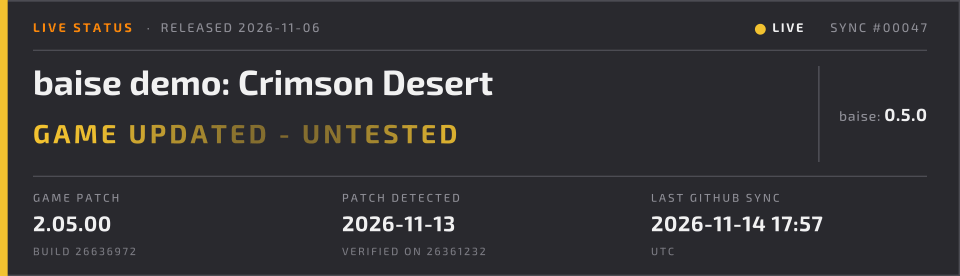
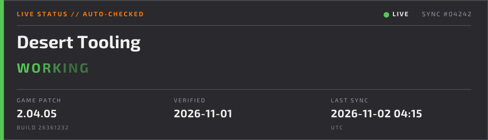
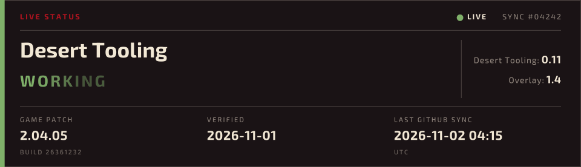
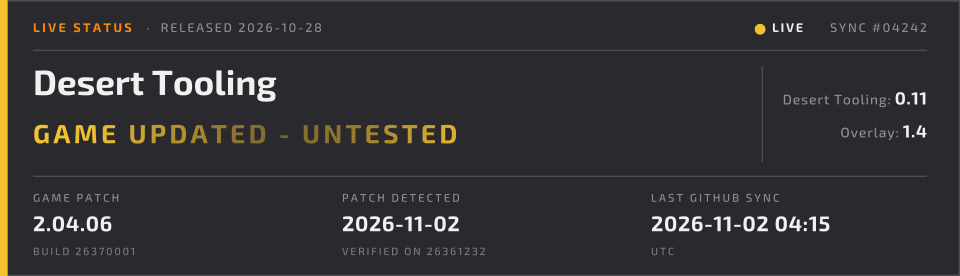
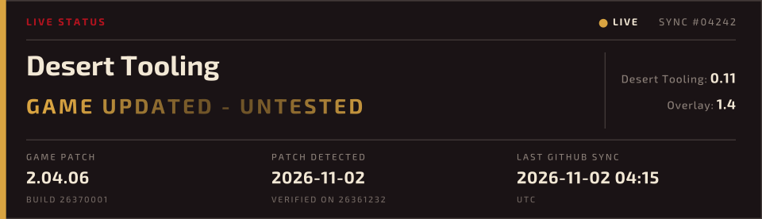
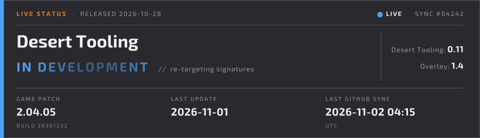
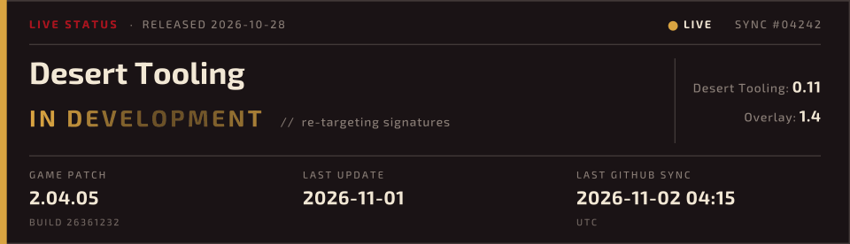
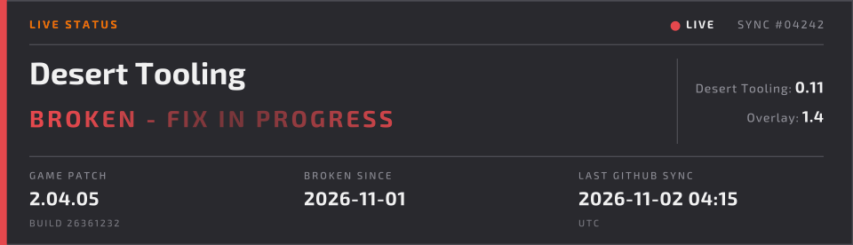
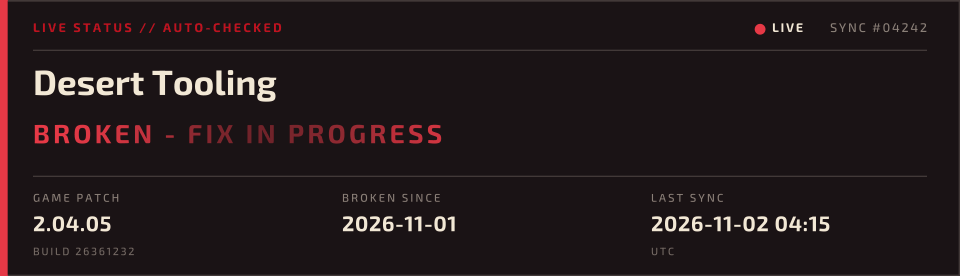

# baise

**Live status badges for game mods.** Every 15 minutes a GitHub Action asks Steam which build the
game is on, compares it with the build each of your mods was verified on, and redraws an animated
card per mod. Your Nexus Mods page hotlinks the card, so visitors see *"working on 2.04.05"* turn
into *"game updated - untested"* within minutes of a patch, without you doing anything.



Plug and play: two files in your repo, no code, any Steam game.

## The bricks

```text
   ┌────────────┐    ┌──────────────────┐
   │  SOURCE    │    │  DECLARATION     │
   │ Steam build│    │ baise.toml       │
   │ + version  │    │ build each mod   │
   │ (or manual)│    │ was verified on  │
   └─────┬──────┘    └────────┬─────────┘
         │   26361232         │   26361232
         └────────┬───────────┘
            ┌─────▼──────┐  equal  -> your status (working / wip / broken)
            │   RULE     │  moved  -> on_update (untested, or broken)
            │ state.json │  pinned -> what you set by hand for this build
            └─────┬──────┘
            ┌─────▼──────┐
            │ RENDERER   │  layout "card" + theme (nexus, crimson-desert, your .toml)
            └─────┬──────┘
            ┌─────▼──────┐
            │  PUBLISH   │  <key>.gif  <key>.png  <key>.json  index.md  state.json
            │ badges     │  -> one force-pushed commit on the `badges` branch
            └────────────┘  -> raw.githubusercontent.com -> your Nexus page
```

| Brick | Answers | Default | Swap it with |
| --- | --- | --- | --- |
| Source | what the game is on now | `steam`: api.steamcmd.net build id + ISteamNews patch version | `[source] kind = "manual"` for games not on Steam |
| Declaration | what each mod was verified on | `baise.toml` in your repo | one `[[mod]]` table per mod |
| Rule | how the two become a status | working if equal, else `on_update` | `on_update = "broken"`; pins via `set` / the Run workflow button |
| Renderer | what the card looks like | `card` layout, `nexus` theme | `theme = "crimson-desert"` or `"./my-theme.toml"` |
| Publish | where the images go | the `badges` branch of your repo | the workflow's `branch` input, or run the CLI anywhere |

## Install (3 steps)

1. Copy [`templates/consumer/baise.toml`](templates/consumer/baise.toml) to your repo's root
   and fill in the Steam `app_id` and one `[[mod]]` per mod.
2. Copy [`templates/consumer/status.yml`](templates/consumer/status.yml) to `.github/workflows/status.yml`:

   ```yaml
   jobs:
     status:
       uses: KiefBC/baise/.github/workflows/status.yml@v0.3.0
   ```

3. Run it once from the Actions tab (*baise -> Run workflow*), then paste the BBCode from
   `index.md` on the new `badges` branch into your Nexus description:

   ```text
   [img]https://raw.githubusercontent.com/<you>/<repo>/badges/<key>.gif[/img]
   ```

Your repo must be **public** for the images to load on Nexus. If the source is private, make a
small public status-only repo from [`templates/standalone/`](templates/standalone/) instead.

After you test a game update, either bump `build` and `date` in `baise.toml` (the card goes
back to WORKING on the next run), or run the workflow by hand with the mod key and a status to pin
it for the current build without a commit.

## The cards

Each card is 960x276, 20 frames at 80 ms, looping: the status letters pulse left to right and the
LIVE dot blinks. Also written per mod: `<key>.png` (frame 0, for sites that reject GIFs) and
`<key>.json`, a [shields.io endpoint](https://shields.io/badges/endpoint-badge) for a small README
badge:

```markdown

```

| | `nexus` | `crimson-desert` |
| --- | --- | --- |
| working |  |  |
| untested |  |  |
| wip |  |  |
| broken |  |  |

| Status | Card says | Middle column |
| --- | --- | --- |
| `working` | WORKING | VERIFIED (your `date`) |
| `untested` | GAME UPDATED - UNTESTED | PATCH DETECTED (first run that saw the new build) |
| `wip` | IN DEVELOPMENT | LAST UPDATE |
| `broken` | BROKEN - FIX IN PROGRESS | BROKEN SINCE |

## `baise.toml`

```toml
[source]
kind = "steam"
app_id = 3321460
version_regex = '(?i)patch notes.*?version\s*(\d+(?:\.\d+)+)'   # optional; this is the default

[render]
layout = "card"
theme = "crimson-desert"        # or "nexus", or "./my-theme.toml"
title_prefix = "LIVE STATUS"

[[mod]]
key = "desert-tooling"          # file names: desert-tooling.gif / .png / .json
label = "Desert Tooling"
build = "26361232"              # the build this mod was verified on
date = "2026-11-01"             # when
status = "working"              # working | broken | wip    (shown while the build matches)
on_update = "untested"          # untested | broken         (shown once Steam moves)
note = ""                       # optional one-liner next to the status
releases = [                    # optional, up to 3 lines on the card: "<name>: <version>"
  { name = "Desert Tooling", version = "0.11" },
  { name = "Overlay",        version = "1.4" },
]
```

`version_regex` runs over the titles of the game's Steam announcements, newest first; group 1 is
the version. If no title matches, the card shows the build number instead.

## Themes

A theme is a TOML file; copy [`themes/nexus.toml`](themes/nexus.toml) and point `render.theme` at
it (the path is relative to `baise.toml`):

```toml
name = "my-theme"

[colors]
background = "#29292E"
accent = "#FF7700"      # header line
text = "#F1F1F1"        # title and values
dim = "#8E8E99"         # labels, rules, SYNC counter
working = "#57C754"
untested = "#F2C230"
wip = "#4FA3F7"
broken = "#E5484D"

[font]
file = "exo2"           # the bundled Exo 2, or a .ttf/.otf path relative to this file
title_weight = 700      # variable fonts only
body_weight = 500
```

## CLI

The workflow runs the same binary you can run locally (`cargo install --git
https://github.com/KiefBC/baise`, or download `baise-x86_64-linux` from a release):

```text
baise check   [--config baise.toml] [--state badges/state.json] [--out badges]
              [--sync N] [--repo owner/name] [--branch badges]
              [--offline --build B [--game-version V]]
baise render  [same paths]              re-draw from state.json, no network
baise set     [--config ...] [--state ...] <key> working|broken|wip|untested|auto [--build B]
baise urls    [--config ...] --repo owner/name [--branch badges]
baise preview [--out preview]           every status in every built-in theme
```

Exit codes: `0` ok, `1` config or state error, `2` the source was unreachable. On `2` nothing is
written and the workflow does not push, so a Steam outage never blanks or falsifies a badge.

`state.json` keeps the first date each build was seen, manual pins, the last build and version,
and the SYNC counter. It lives on the `badges` branch next to the images, never on `main`, so your
history never sees a bot commit.

## Caveats

- GitHub's cron is best effort: `*/15` can run late or skip under load, and
  raw.githubusercontent.com caches files for about 5 minutes.
- GitHub disables scheduled workflows in public repos after 60 days without activity and emails
  you; the bot's force-push to `badges` may not count as activity. Running the workflow by hand
  re-arms it.
- api.steamcmd.net is a third-party mirror of SteamCMD's data. If it is down, runs exit with code
  2 and the last good card stays up. `steamcmd +app_info_print <appid>` is the slow fallback if it
  ever goes away for good.
- Private repos cannot be hotlinked; use the standalone template in a public repo.

## Developing

`nix develop` gives stable Rust with the musl target; `just` lists the recipes. `just ci` is what a
commit should pass (fmt, clippy with `-D warnings`, the tests, the 8 previews, the version pins);
`just release` builds the static `x86_64-unknown-linux-musl` binary; `just demo 99999999` runs an
offline check that shows the UNTESTED card in `target/demo/`.

Releasing: bump `version` in `Cargo.toml`, the `version` default in
`.github/workflows/status.yml`, the `@v…` in both templates and this README (`just check-pins`
lists any that disagree), then tag `v<version>`; `release.yml` attaches the binary.

## License

MIT. The bundled font is [Exo 2](https://github.com/googlefonts/Exo-2.0) by Natanael Gama,
SIL Open Font License 1.1 ([fonts/OFL.txt](fonts/OFL.txt)).
